# AlgoDesign: getting started

In this guide you learn to define your first algorithm with AlgoDesign, step by step: read a whole number and write whether it is even or odd. Every command is explained in full in the student guide, `STUDENT-GUIDE.md`; how to download and start AlgoDesign is in the `README.md` file.

## 1. A new project

From the **Project** menu choose **New**. Type the name of the project, `even or odd`, and press **Create**.

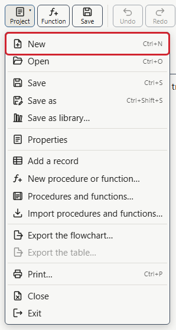

## 2. The data item

In AlgoDesign you first say what you need, the data, and then how you use them, the rules of the flowchart. Here a single data item is needed: the number to read.

In the “Data” tab, on the left, press **Add a data item**. In the **Name** field type `number`, leave the type **integer** and as the **Role** choose **input**, because the value comes from whoever uses the program. Then press **Confirm**.

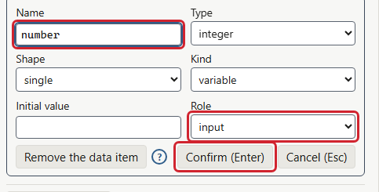

## 3. The Read

In the flowchart, on the right, between “Start” and “End”, there is a **+**, which shows up with the mouse pointer over the flowchart. Click the **+**: the list of blocks opens. Choose **Read**.

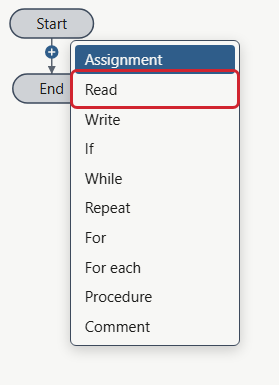

In the **Target** field type `number` and press **Confirm**, or Enter. The block waits for a value typed in the console and puts it in the data item.

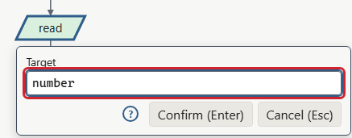

## 4. The If and the two Writes

Below the Read there is another **+**: click it and choose **If**. In the **Condition** field type `number mod 2 == 0` and confirm: `mod` is the remainder of the division, and the remainder of the division by 2 is zero when the number is even.

The If has two branches, each with its **+**: **True** on the right, **False** on the left. In the True branch insert a **Write** with the value `"even"`, in quotes because it is a text, and with the **New line** box. In the False branch a **Write** with `"odd"`, also with **New line**.

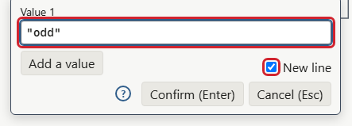

The flowchart is finished:

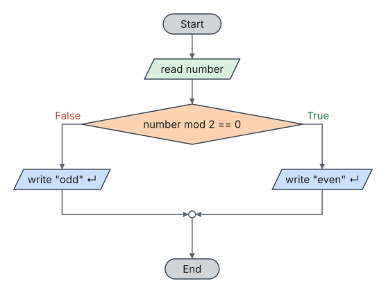

Save the project with **Save as** (Ctrl+Shift+S), from the **Project** menu: the file has the `.algo` extension.

## 5. Running step by step

Press **Step** (F10) in the toolbar: on the right of the flowchart the **trace table** and the **console** appear. Press **Step** again: the program reaches the Read and waits. At the bottom of the console type `7` and press Enter.

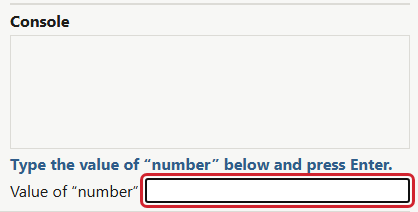

Each **Step** is one action. Press **Step** again: the condition is false, because 7 is odd, and the block highlighted in yellow, the one about to run, is the Write of “odd”.

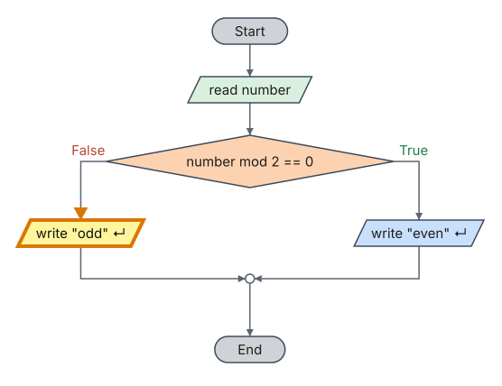

The trace table has one row for each action: the value of each data item and the outcome of the condition.

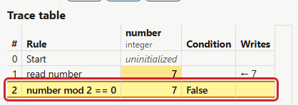

Press **Continue** (F5), the button that takes the place of “Run” during the run, to reach the end: the console writes `odd`.

## 6. A test case

A test case is a check to repeat: the values to type in the console and the output the program must give. The simplest one comes from the run that has just finished: at the bottom of the console click **Save the run as a test case**.

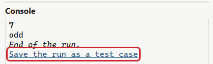

The “Test cases” tab opens with the case already prepared, with the value `7` and the expected output `odd`: press **Confirm**. Then press **Run all**: the green dot next to the case says that the program gave the expected output. Every time you change the flowchart, **Run all** repeats the checks with one click.

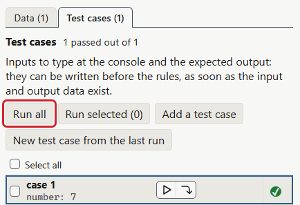

## 7. The generated code

Press **Code** in the toolbar: on the right of the flowchart the program appears written in pseudocode, in Python and in C, one tab per language. The code follows every change of the flowchart, and while running step by step it highlights the line of the current block.

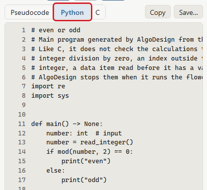

## 8. What next

- From the **Help** menu, **Examples…** lists twelve examples to try, divided into groups.
- From the **Help** menu, **Student guide** opens the complete guide, in a window next to the flowchart: loops, records, procedures and functions, printing and the Settings.

## 9. License of this guide

This guide, text and figures, is by Giuseppe Lancellotti and is released under the Creative Commons Attribution 4.0 International license (CC BY 4.0): it can be copied, distributed and modified, also for commercial purposes, crediting the author and the license. The full text of the license is in the `LICENSE-DOCS` file.
