# AlgoDesign: per cominciare

In questa guida impari a definire il primo algoritmo con AlgoDesign, passo per passo: leggere un numero intero e scrivere se è pari o dispari. Ogni comando è spiegato per intero nella guida per lo studente, `GUIDA-PER-LO-STUDENTE.md`; come si scarica e si avvia AlgoDesign è nel file `LEGGIMI.md`.

## 1. Un progetto nuovo

Dal menu **Progetto** scegli **Nuovo**. Scrivi il nome del progetto, `pari o dispari`, e premi **Crea**.

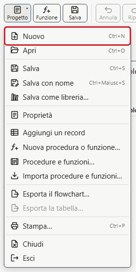

## 2. Il dato

In AlgoDesign prima si dice che cosa serve, i dati, poi come si usano, le regole del flowchart. Qui serve un dato solo: il numero da leggere.

Nella scheda «Dati», a sinistra, premi **Aggiungi un dato**. Nel campo **Nome** scrivi `numero`, lascia il tipo **intero** e come **Ruolo** scegli **input**, perché il valore arriva da chi usa il programma. Poi premi **Conferma**.

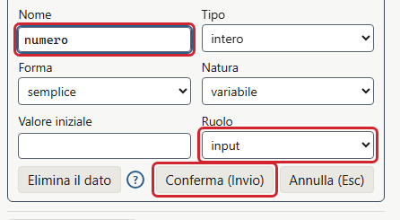

## 3. La Lettura

Nel flowchart, a destra, fra «Inizio» e «Fine», c'è un **+**, che si vede col puntatore del mouse sopra il flowchart. Fai clic sul **+**: si apre l'elenco dei blocchi. Scegli **Lettura**.

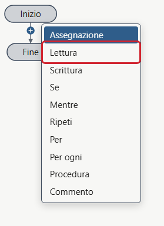

Nel campo **Destinazione** scrivi `numero` e premi **Conferma**, o Invio. Il blocco aspetta un valore scritto nella console e lo mette nel dato.

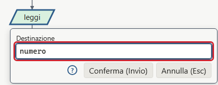

## 4. Il Se e le due Scritture

Sotto la Lettura c'è un altro **+**: fai clic e scegli **Se**. Nel campo **Condizione** scrivi `numero mod 2 == 0` e conferma: `mod` è il resto della divisione, e il resto della divisione per 2 è zero quando il numero è pari.

Il Se ha due rami, ognuno col suo **+**: **Vero** a destra, **Falso** a sinistra. Nel ramo Vero inserisci una **Scrittura** con il valore `"pari"`, fra virgolette perché è un testo, e con la casella **Va a capo**. Nel ramo Falso una **Scrittura** con `"dispari"`, anche lei con **Va a capo**.

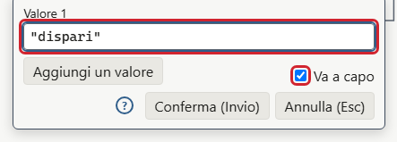

Il flowchart è finito:

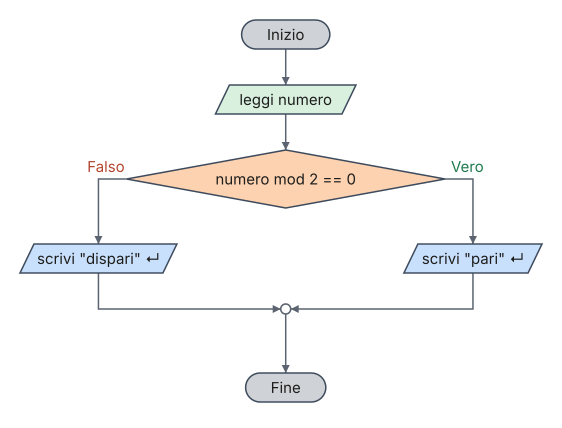

Salva il progetto con **Salva con nome** (Ctrl+Maiusc+S), dal menu **Progetto**: il file ha l'estensione `.algo`.

## 5. Eseguire passo passo

Premi **Passo** (F10) nella barra: a destra del flowchart compaiono la **tabella di traccia** e la **console**. Premi ancora **Passo**: il programma arriva alla Lettura e aspetta. In fondo alla console scrivi `7` e premi Invio.

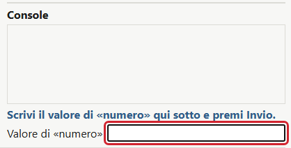

Ogni **Passo** è un'azione. Premi ancora **Passo**: la condizione è falsa, perché 7 è dispari, e il blocco evidenziato in giallo, quello che sta per essere eseguito, è la Scrittura di «dispari».

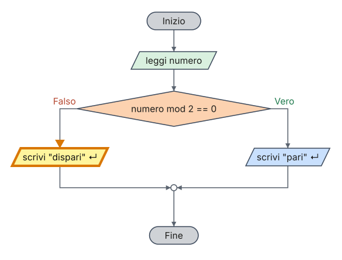

La tabella di traccia ha una riga per ogni azione: il valore di ogni dato e l'esito della condizione.

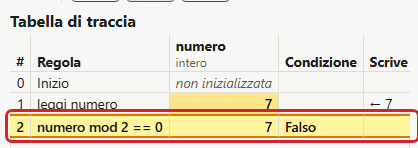

Premi **Continua** (F5), il pulsante che durante l'esecuzione prende il posto di «Esegui», per arrivare alla fine: la console scrive `dispari`.

## 6. Un caso d'uso

Un caso d'uso è una prova da ripetere: i valori da scrivere nella console e l'output che il programma deve dare. Il più semplice nasce dall'esecuzione appena finita: in fondo alla console fai clic su **Salva l'esecuzione come caso d'uso**.

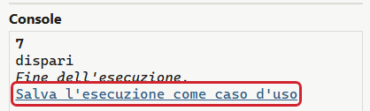

Si apre la scheda «Casi d'uso» con il caso già pronto, col valore `7` e l'output atteso `dispari`: premi **Conferma**. Poi premi **Esegui tutti**: il pallino verde accanto al caso dice che il programma ha dato l'output atteso. Ogni volta che cambi il flowchart, **Esegui tutti** ripete le prove con un clic.

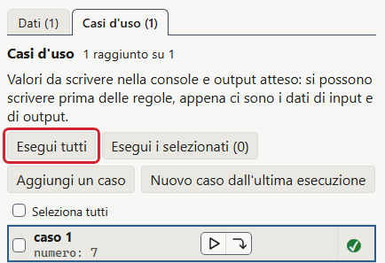

## 7. Il codice generato

Premi **Genera** nella barra: a destra del flowchart compare il programma scritto in pseudocodice, in Python e in C, una linguetta per linguaggio. Il codice segue ogni modifica del flowchart, e durante l'esecuzione passo passo evidenzia la riga del blocco corrente.

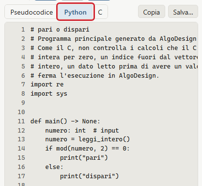

## 8. E adesso

- Dal menu **Aiuto**, **Esempi…** sono elencati dodici esempi da provare, divisi in gruppi.
- Dal menu **Aiuto**, **Guida per lo studente** si apre la guida completa, in una finestra accanto al flowchart: i cicli, i record, le procedure e le funzioni, la stampa e le Impostazioni.

## 9. Licenza di questa guida

Questa guida, testo e figure, è di Giuseppe Lancellotti ed è rilasciata con licenza Creative Commons Attribuzione 4.0 Internazionale (CC BY 4.0): si può copiare, distribuire e modificare, anche per scopi commerciali, citando l'autore e la licenza. Il testo completo della licenza è nel file `LICENSE-DOCS`.
